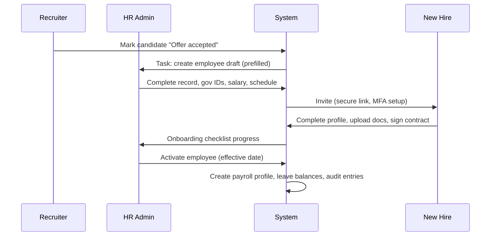
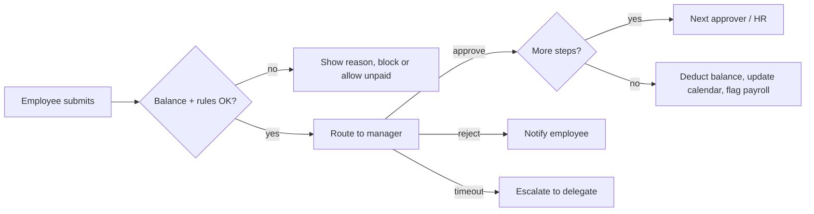
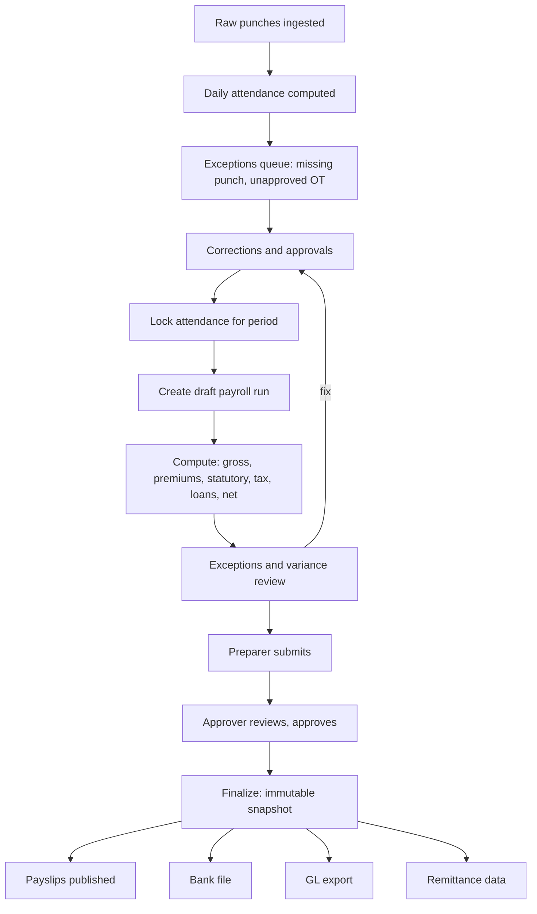
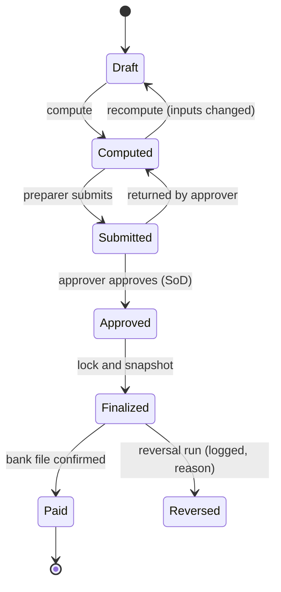
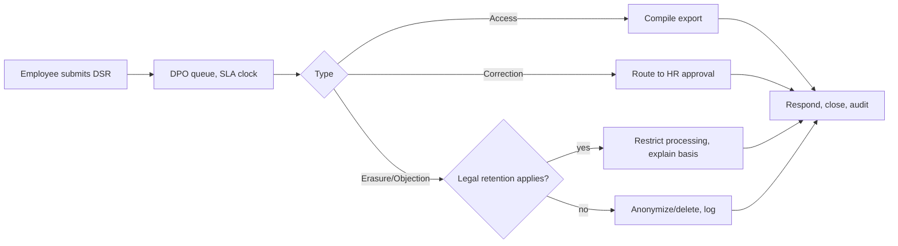
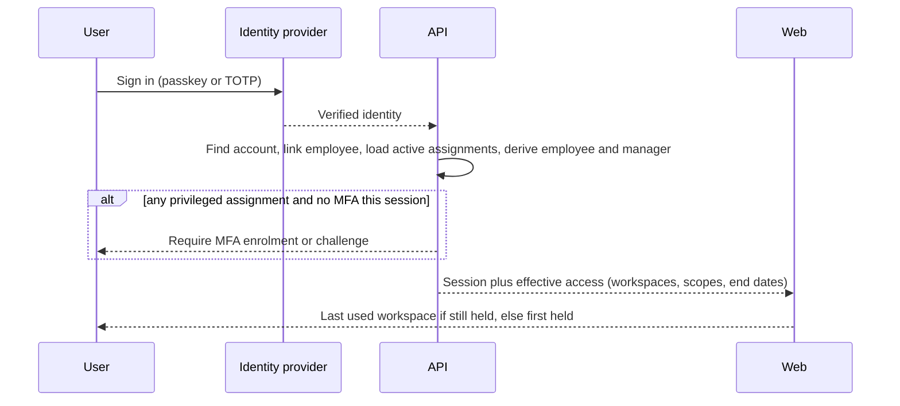
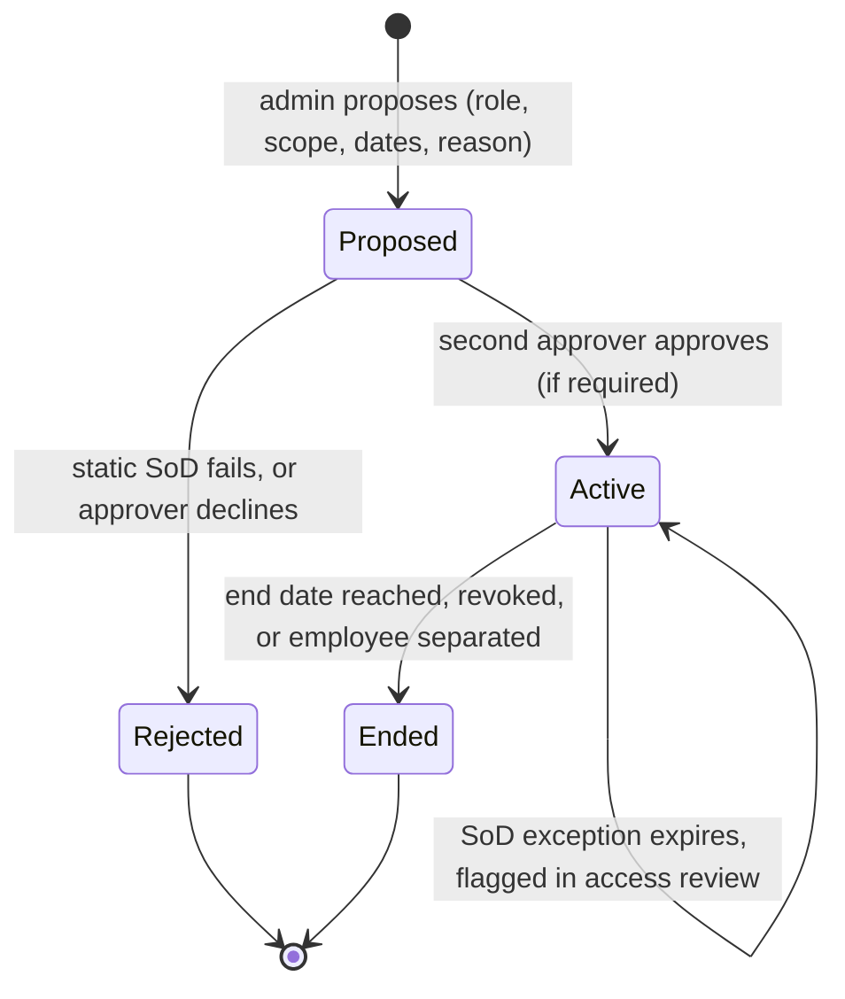
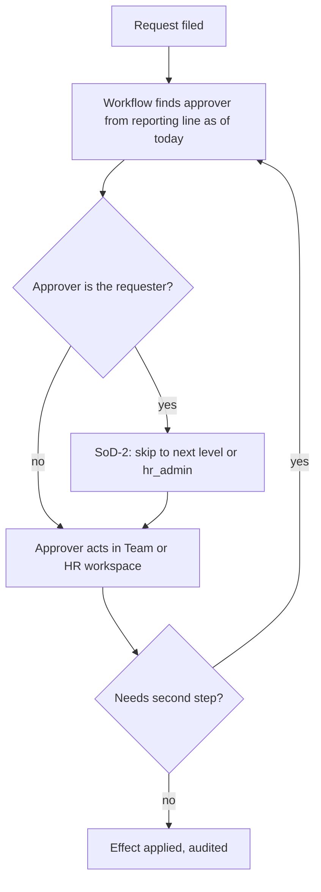

# Application Flows

Mermaid diagrams (render in GitHub/VS Code). Screens are named for later wireframing.

## 1. Global navigation (information architecture, by workspace)
The top level is the **workspace**, not the module. A user sees only the workspaces backed by an active role assignment ([ADR-013](../03-design/adr/ADR-013-multi-role-access-model.md)). A user with only the employee role sees no workspace strip at all.

```mermaid
flowchart TD
  Login --> MFA --> Resolve[Resolve effective access]
  Resolve --> Me[Me]
  Resolve --> Team[Team]
  Resolve --> HR[HR]
  Resolve --> Payroll[Payroll]
  Resolve --> Dash[Dashboards]
  Resolve --> Privacy[Privacy]
  Resolve --> Admin[Admin]
  Resolve --> Audit[Audit]
  Me --> E1[Payslips] & E2[Leave] & E3[Attendance] & E4[Profile] & E5[Documents] & E6[Requests] & E7[My roles]
  Team --> M1[Approvals] & M2[Team calendar] & M3[Reviews]
  HR --> H1[People] & H2[Org] & H3[Onboarding] & H4[Offboarding] & H5[Leave policy] & H6[Time and schedules]
  Payroll --> P1[Pay periods] & P2[Runs] & P3[Loans] & P4[Statutory] & P5[Bank files] & P6[Rule sets]
  Dash --> D1[Headcount] & D2[Payroll cost]
  Privacy --> V1[Requests] & V2[Breach log] & V3[Retention]
  Admin --> A1[Users] & A2[Role assignments] & A3[Workflow] & A4[Integrations] & A5[Access review]
  Audit --> U1[Audit log and export]
```

Entry permission per workspace is in [HLD §6](../03-design/hld/high-level-design.md). Recruitment moves to a `Recruit` workspace when the ATS ships (post-GA).

## 2. Hire to active employee

## 3. Leave request

## 4. Time to payroll cycle

## 5. Payroll run states

## 6. Data subject request

## 7. Offboarding
Resignation/termination recorded → clearance checklist (assets, accountabilities) → final pay computation → approval → release → access revoked at effective date → record moved to retention state → scheduled anonymization.

## 8. Key screens (wireframes now in [wireframes/](wireframes/README.md))
Login/MFA · Home (role-aware) · Employee list · Employee profile (tabs: Personal, Employment, Pay, IDs, Documents, History, Leave, Attendance) · Import wizard · Schedule editor · Attendance grid · Approvals inbox · Payroll run workspace (exceptions-first) · Payslip with "explain" drawer · Statutory exports · Privacy console · Audit viewer · Settings (roles, workflows, holidays, rule sets).

## 9. Sign-in and workspace resolution

If the last-used workspace is no longer held, the user lands on Me and sees a one-line notice.

## 10. Role assignment lifecycle

Rules: proposer cannot approve their own proposal; payroll, DPO and admin roles need a second approver; `auditor` needs an end date of 90 days at most; ending employment ends every granted assignment in one transaction and revokes sessions. Changes rotate the user's session and show "Your access changed. Reload to continue."

## 11. Approval routing for people with several roles

A person who is both HR admin and manager sees their team's requests in **Team** and everything else in **HR**; their own requests never appear in their own approval lists.

## 12. Key screens (updated)
Login/MFA · Home per workspace · People list · Employee 201 file (catalogue strip, hanging labels; sections Personal, Employment, Pay, IDs, Documents, History, Leave, Attendance) · Import wizard · Schedule editor · Attendance grid · Approvals inbox · Payroll run workspace (exceptions first) · Payslip with "explain" drawer · Statutory exports · Role assignments (propose, approve, SoD result) · My roles · Access review · Privacy console · Audit viewer. Visual direction: [ui-design-system](../03-design/ui-design-system.md), live example: [ui-preview](../03-design/hld/ui-preview.html).
