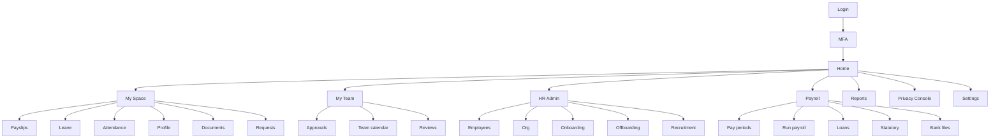
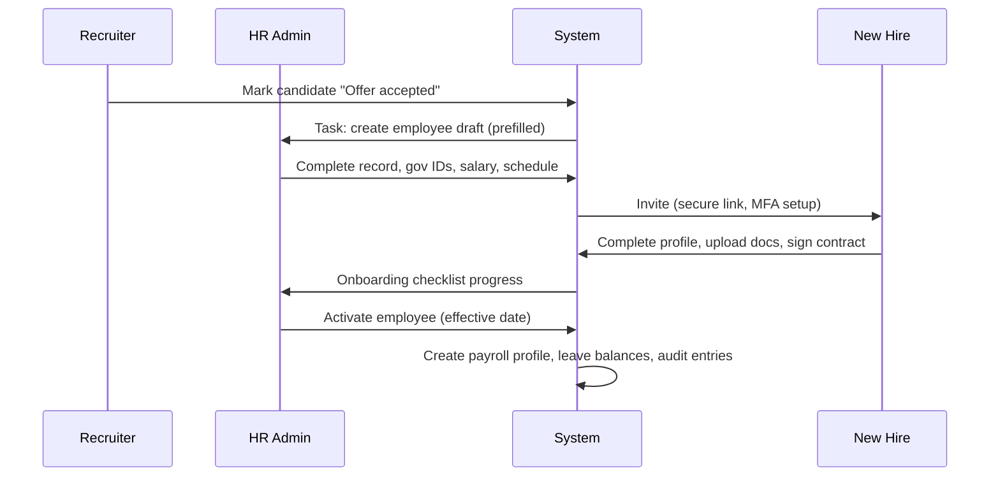
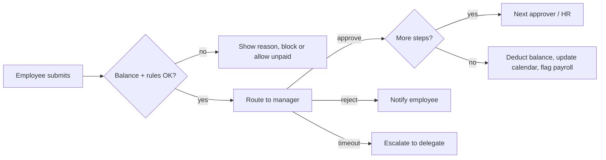
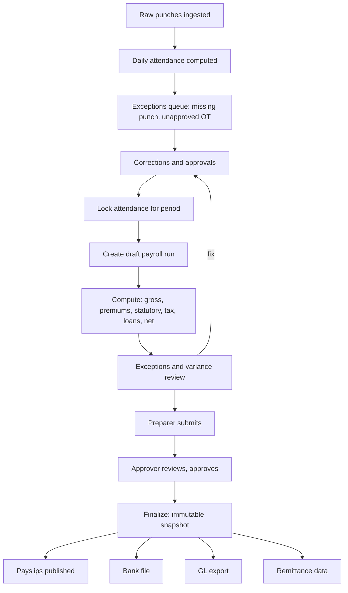
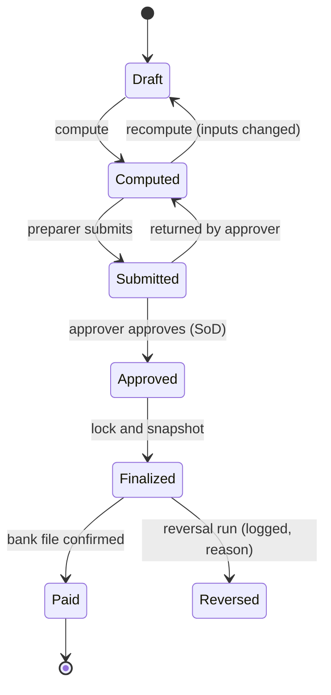
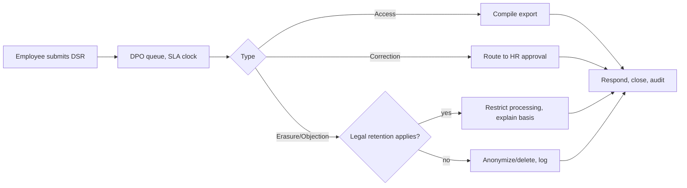

# Application Flows

Mermaid diagrams (render in GitHub/VS Code). Screens are named for later wireframing.

## 1. Global navigation (information architecture)

## 2. Hire to active employee

## 3. Leave request

## 4. Time to payroll cycle

## 5. Payroll run states

## 6. Data subject request

## 7. Offboarding
Resignation/termination recorded → clearance checklist (assets, accountabilities) → final pay computation → approval → release → access revoked at effective date → record moved to retention state → scheduled anonymization.

## 8. Key screens (wireframes now in [wireframes/](wireframes/README.md))
Login/MFA · Home (role-aware) · Employee list · Employee profile (tabs: Personal, Employment, Pay, IDs, Documents, History, Leave, Attendance) · Import wizard · Schedule editor · Attendance grid · Approvals inbox · Payroll run workspace (exceptions-first) · Payslip with "explain" drawer · Statutory exports · Privacy console · Audit viewer · Settings (roles, workflows, holidays, rule sets).
