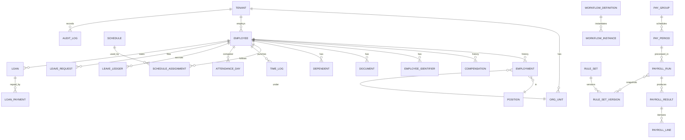

# Data Model (Conceptual → Logical)

## ER overview

## Key table notes
| Table | Notes |
|---|---|
| employee | Stable identity only (id, number, names, DOB_enc?). Changing facts live in effective-dated children |
| employee_identifier | `type`, `value_enc`, `value_bidx` (HMAC), `last4` for display |
| compensation | `rate_amount numeric(19,4)` encrypted at rest via column encryption wrapper, `rate_type`, `working_days_factor`, `is_mwe`, `tax_status` |
| time_log | Append-only; unique `(tenant_id, device_id, employee_ref, ts)` |
| attendance_day | `business_date date`, minutes columns, `rule_version_ids`, recomputable; locked by period |
| leave_ledger | `entry_type`, `quantity numeric(7,3)`, `effective_date`, `source_ref`; append-only |
| payroll_run | `status`, `run_type`, `input_snapshot_hash`, `rule_versions jsonb`, `preparer_id`, `approver_id`, `finalized_at` |
| payroll_result | `employee_id`, totals, `trace jsonb` (compressed), immutable after finalize (trigger) |
| rule_set_version | `agency`, `type`, `effective_from`, `effective_to`, `data jsonb`, `source_citation`, `checksum`, `approved_by` |
| audit_log | See LLD §6 |

## Conventions
- UUIDv7 primary keys (time-sortable).
- `tenant_id` on every table, first column in composite indexes.
- `created_at`, `updated_at`, `created_by`, `updated_by` standard (except append-only tables).
- Soft delete only where legally needed; otherwise anonymize via retention job.
- Money `numeric(19,4)`; hours/minutes as integers of minutes.
- All enums are lookup tables or CHECK-constrained text for easy evolution.

## Reporting model
Initial: SQL views over OLTP. Later: nightly materialised summary tables (headcount snapshot, payroll cost by cost center). Reporting reads must honour RLS and masking.

## Data migration
Import staging tables → validation → commit in a single transaction per batch with rollback token. See US-103, US-807.
