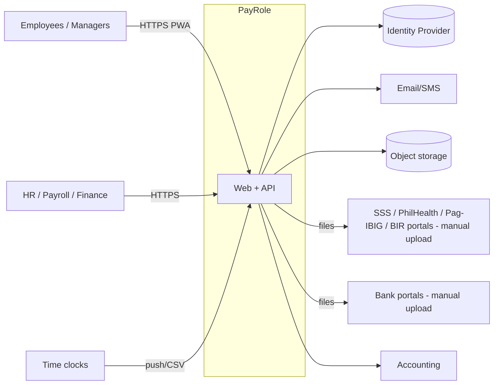
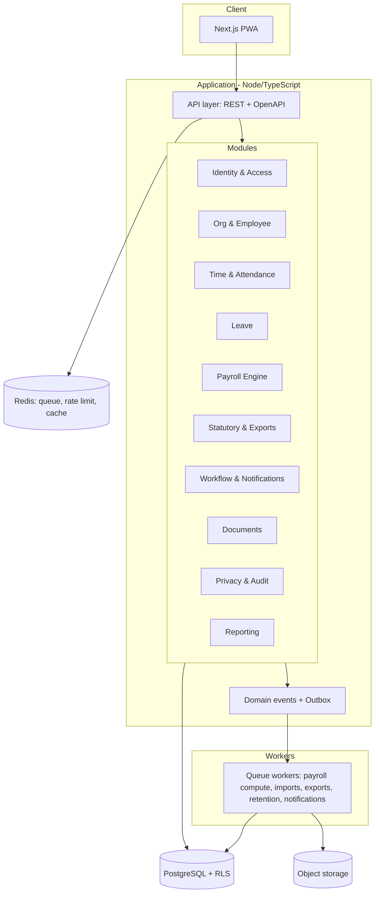
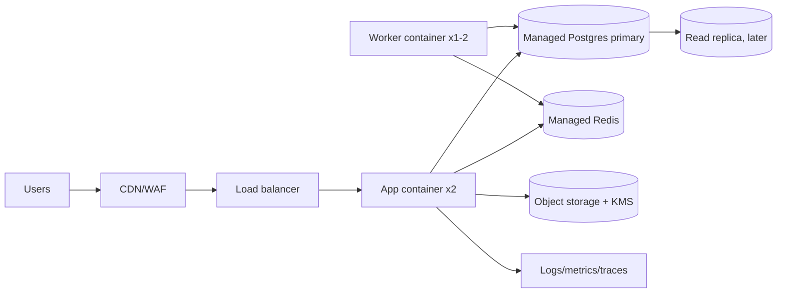

# High-Level Design

Status: Draft v0.1. Decisions referenced as ADR-nnn.

## 1. Context

Government and bank portals are touched by humans; the system only generates files (OD-07).

## 2. Architecture style
**Modular monolith** (ADR-001): one deployable, strict module boundaries, in-process events plus an outbox, background workers on a queue. Rationale: solo developer, strong transactional consistency needs (payroll), simpler ops. Modules can be extracted later along existing seams.

## 3. Key architectural drivers
| Driver | Response |
|---|---|
| Payroll correctness | Pure-function payroll engine; rules as versioned data; snapshot + determinism tests (ADR-005, TDD-payroll-engine) |
| Privacy/security | RLS tenancy, field-level encryption, audit chain, least privilege (ADR-004, -007, -010) |
| Solo operability | Boring stack, managed services, IaC, few moving parts (ADR-001, -002) |
| Effective dating | Bitemporal-lite tables (valid_from/valid_to + recorded_at) (ADR-008) |
| Integrations unstable | Adapters and outbox, file-generation only (ADR-003) |
| Mobile-first | PWA, small payloads, server components where useful |

## 4. Module responsibilities and boundaries
| Module | Owns | Exposes | Depends on |
|---|---|---|---|
| IAM | users, roles, sessions, MFA binding | `authorize(actor, action, resource)` | IdP |
| Org & Employee | org, position, employee, compensation, identifiers | queries as-of date | IAM, Documents |
| Time & Attendance | schedules, holidays, raw logs, attendance days | `attendance(period)` | Employee, Leave |
| Leave | types, policies, ledger, requests | `leaveImpact(period)` | Employee, Workflow |
| Payroll | pay groups, runs, results, loans | `finalizedRun`, payslips | Employee, Time, Leave, Rules |
| Rules | rule sets (statutory, holiday, premium) | `ruleAt(type, date)` | none |
| Statutory & Exports | file generators | files | Payroll |
| Workflow | definitions, instances, tasks | `start/advance` | IAM |
| Notifications | templates, delivery | `notify()` | IdP/email |
| Documents | vault, scan, signed URLs | | Storage |
| Privacy & Audit | audit chain, DSR, retention, breach | `audit()` | all (write-only consumers) |
| Reporting | read models | | read replicas/views |

Rule: modules talk through public interfaces and events; no cross-module table access (enforced by lint/arch tests, e.g. dependency-cruiser).

## 5. Deployment view

Environments: local, dev (ephemeral PR previews optional), staging (prod-like), prod. Details: [deployment](../06-operations/deployment.md).

## 6. Cross-cutting concerns
- **Authentication** OIDC, short-lived access tokens, server-side sessions for web (ADR-006).
- **Authorization** central policy function (RBAC + scope + purpose); enforced in service layer, never UI-only.
- **Tenancy** `tenant_id` on every table; RLS policies; session variable `app.tenant_id` set per transaction.
- **Audit** domain events → audit writer; hash chaining per tenant.
- **Config & rules** tenant settings vs. global statutory rule sets (global read-only, tenant overrides allowed where law permits).
- **Errors** problem+json with correlation ID.
- **i18n/time/money** libraries centralised (Temporal-like date handling, decimal.js/Postgres numeric).

## 7. Data architecture (summary)
PostgreSQL system of record. Normalised OLTP. Append-only: audit_log, time_log_raw, leave_ledger, payroll_result after finalization. Reporting via SQL views/materialised views initially. Details: [data-model](data-model.md).

## 8. Quality attribute strategies
See [NFRs](../02-requirements/non-functional-requirements.md), [testing-strategy](../05-quality/testing-strategy.md), [security](../04-security/README.md).

## 9. Risks and open technical questions
- Compute-heavy payroll in Node: acceptable at 500 emp (NFR-02); fallback = worker pool or extracted service.
- RLS performance with complex policies: benchmark in M0.
- Singapore hosting latency from Manila: measure in M0 against NFR-01; residency handled by contract (ADR-011).
- Field-level encryption vs searchability: blind indexes (LLD §Crypto).
