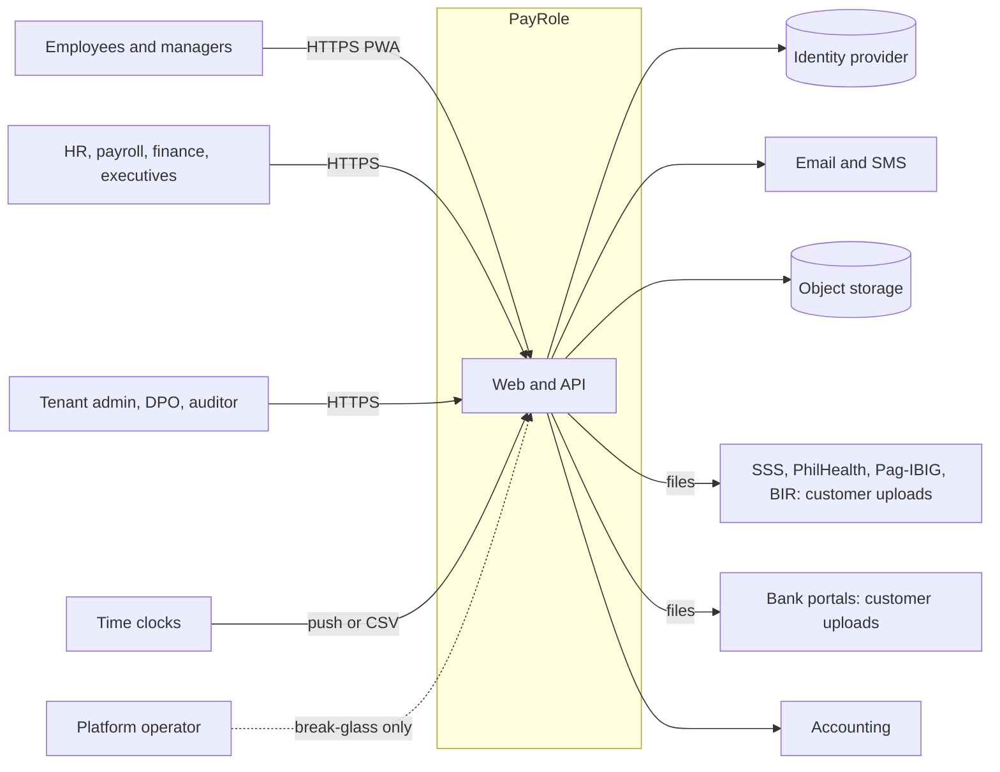
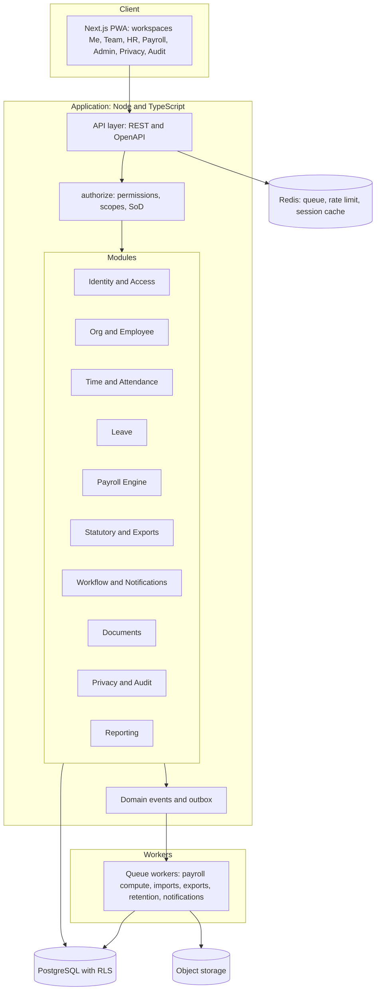
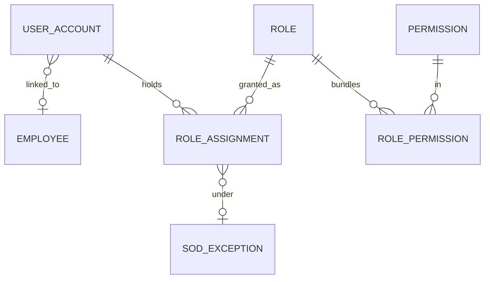
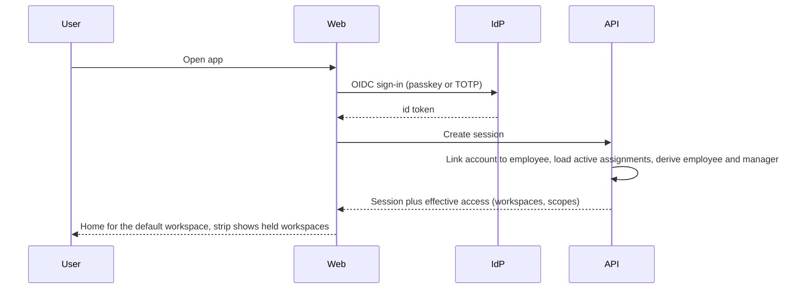
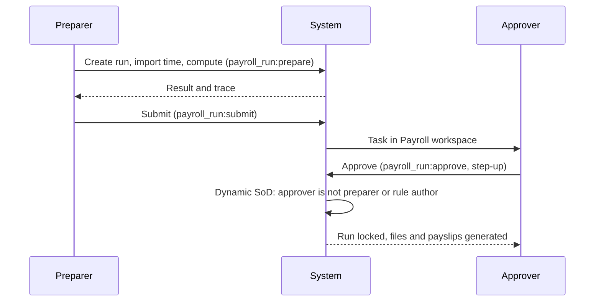
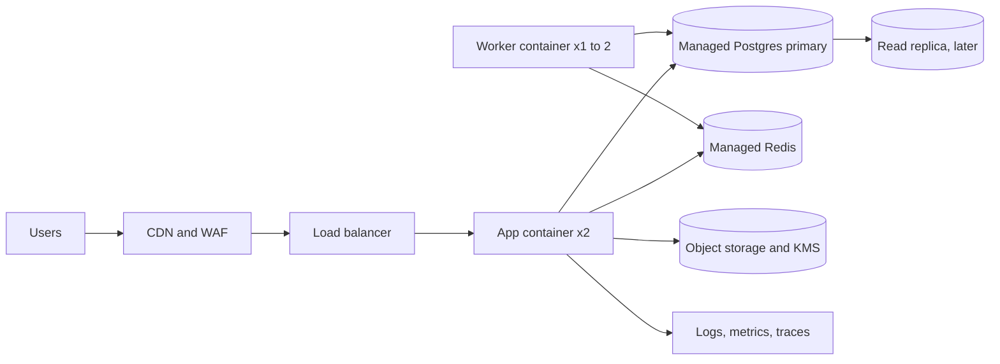

# High-Level Design

Status: **Draft v0.2 for owner review** (2026-11-17). Supersedes v0.1. Visual version: [hld.html](hld.html) (open in a browser). UI look and feel: [ui-design-system](../ui-design-system.md) and [ui-preview.html](ui-preview.html).

What changed from v0.1: multi-role access model ([ADR-013](../adr/ADR-013-multi-role-access-model.md)), a frontend architecture organised by workspace, the design language ([ADR-014](../adr/ADR-014-ui-design-language.md)), a seed-data strategy, C4-style levels, key flows, and a decision table. Full change list: [change record](../../00-overview/change-record-2026-11-17.md).

## 0. Review checklist for the owner
Please confirm or change each before any code is written:
1. Roles: the 12 roles and 7 SoD rules in §5 (and [roles-and-permissions](../../02-requirements/access/roles-and-permissions.md)).
2. Workspaces as the frontend unit (Me, Team, HR, Payroll, Admin, Privacy, Audit) in §6.
3. Swiss-style design direction ([ADR-014](../adr/ADR-014-ui-design-language.md)) and the preview.
4. Seed data scope in §9.
5. HLD decisions D-01 to D-12 in §12.

## 1. System context (C4 level 1)

Government and bank portals are touched by humans; the system only generates files (OD-07, ADR-003).

## 2. Architecture style
**Modular monolith** (ADR-001): one deployable, strict module boundaries, in-process events plus an outbox, background workers on a queue. Rationale: solo developer, strong transactional consistency (payroll), simpler operations. Modules can be extracted later along existing seams.

## 3. Containers (C4 level 2)

## 4. Modules and boundaries
| Module | Owns | Exposes | Depends on |
|---|---|---|---|
| Identity and Access (IAM) | user accounts, roles, permissions, role assignments, SoD rules, sessions, MFA binding | `authorize(actor, permission, resource, purpose?)`, `effectiveAccess(actor)` | IdP |
| Org and Employee | org tree, positions, employee, employment, compensation, identifiers | queries as-of date, reporting-line subtree | IAM, Documents |
| Time and Attendance | schedules, holidays, raw logs, attendance days | `attendance(period)` | Employee, Leave |
| Leave | types, policies, ledger, requests | `leaveImpact(period)` | Employee, Workflow |
| Payroll | pay groups, runs, results, loans | `finalizedRun`, payslips | Employee, Time, Leave, Rules |
| Rules | rule sets (statutory, holiday, premium) | `ruleAt(type, date)` | none |
| Statutory and Exports | file generators | files | Payroll |
| Workflow | definitions, instances, tasks | `start`, `advance` | IAM |
| Notifications | templates, delivery | `notify()` | IdP, email |
| Documents | vault, scan, signed URLs | | Storage |
| Privacy and Audit | audit chain, DSR, retention, breach | `audit()` | all (write-only consumers) |
| Reporting | read models | | read replicas, views |

Rule: modules talk through public interfaces and events; no cross-module table access (dependency-cruiser in CI).

## 5. Access architecture (multi-role)
Decision: [ADR-013](../adr/ADR-013-multi-role-access-model.md). Detail: [roles-and-permissions](../../02-requirements/access/roles-and-permissions.md).

- **One account per human.** Roles are many per account, each assignment has a scope (`self`, `team`, `org_unit`, `pay_group`, `tenant`), validity dates, grantor, approver and reason.
- **Derived roles.** `employee` and `manager` come from facts (employment, reporting line), never from grants.
- **Twelve roles:** employee, manager, executive, timekeeper, hr_admin, payroll_preparer, payroll_approver, tenant_admin, dpo, auditor, recruiter (disabled until ATS), platform_ops (separate realm). Plus tenant custom roles.
- **Request path:** session → active assignments (cached) → `authorize()` → permission ∩ scope → step-up and purpose checks → dynamic SoD → field mask → audit. Default deny.
- **SoD:** seven rules; static pairs rejected when an assignment is proposed, dynamic rules checked per action. Only SoD-5 and SoD-6 allow a time-boxed, second-approved exception.
- **The UI cannot grant anything.** The workspace strip filters navigation; the server ignores it.

## 6. Frontend architecture
- **Unit of navigation = workspace.** Next.js route groups `/me`, `/team`, `/hr`, `/payroll`, `/admin`, `/privacy`, `/audit`. A workspace is visible when the user's effective access includes at least one of its entry permissions (for example `employee:read` with scope `tenant` for HR).
- **Server-first.** Server components fetch through the API with the user's session; no authorization logic in client code beyond hiding links. A route guard calls `effectiveAccess()` and renders only allowed navigation; a direct URL to a forbidden page returns 403 from the API.
- **Design system package** (`ui/`): tokens (CSS variables), Radix or React Aria primitives, the catalogue strip, workspace strip, scope chip, approval block, masked value, dense table. See [ui-design-system](../ui-design-system.md).
- **Form and validation:** zod schemas shared with the API.
- **State:** server state via the framework cache; minimal client state; optimistic updates only for non-financial actions.
- **PWA:** offline shell, WebAuthn, web push for approvals; no offline writes for payroll.
- **Accessibility and visual tests:** axe on every route, Playwright screenshots of shell, record page, dense table and form on desktop and mobile.

## 7. Key flows
**Sign-in and role resolution**

**Payroll run with separation of duties**

**Leave approval:** employee files (`leave:request`, scope self) → workflow routes to the manager of the effective-dated reporting line → manager approves (`leave:approve`, scope team) → ledger entry. If the requester is the approver (manager loop), SoD-2 routes to the next level or to `hr_admin`.

## 8. Cross-cutting concerns
- **Authentication:** OIDC, short-lived tokens, server-side sessions (ADR-006).
- **Authorization:** one `authorize()` function; enforced in the service layer; never UI-only.
- **Tenancy:** `tenant_id` on every table; RLS; `app.tenant_id` set per transaction (ADR-004).
- **Audit:** domain events to the audit writer; hash chain per tenant; every authorization decision for S3 and S4 data is recorded.
- **Rules and config:** global statutory rule sets are read-only; tenants may override only where law permits (ADR-005).
- **Errors:** problem+json with correlation ID.
- **i18n, time, money:** central libraries; en-PH strings externalised; `numeric(19,4)` and decimal.js; Asia/Manila.

## 9. Data architecture and seed data
PostgreSQL is the system of record. Normalised OLTP. Append-only: audit_log, time_log_raw, leave_ledger, role_assignment history, payroll_result after finalization. Detail: [data-model](../data-model.md).

**Seed data** ([db/seed](../../../db/seed/README.md)): one fictional tenant ("Casa Verde Trading Corp.", 26 employees, 2 pay groups) with synthetic people only. It covers every role including multi-role users, a manager loop, a time-boxed auditor and one SoD exception, plus org tree, schedules, holidays, leave types and balances, pay periods, workflow definitions. It contains **no real statutory rates**: rule sets are placeholders tagged VERIFY. Fake identifiers use an unmistakable pattern (`DEV-`) so they can never be mistaken for real SSS, TIN, PhilHealth or Pag-IBIG numbers. Used by local development, tests and the UI preview.

## 10. Deployment view

Environments: local, dev, staging (synthetic data only), prod. Details: [deployment](../../06-operations/deployment.md).

## 11. Quality attribute strategies
| Driver | Response |
|---|---|
| Payroll correctness | Pure-function engine, rules as versioned data, snapshot and determinism tests (ADR-005, TDD-payroll-engine) |
| Privacy and security | RLS tenancy, field-level encryption, audit chain, least privilege, SoD (ADR-004, -007, -010, -013) |
| Least privilege with real org structures | Many scoped assignments per user, derived roles, time-boxed grants |
| Solo operability | Boring stack, managed services, IaC, few moving parts (ADR-001, -002) |
| Effective dating | Valid-from and valid-to plus recorded-at on history tables (ADR-008) |
| Integrations unstable | Adapters and outbox, file generation only (ADR-003) |
| Usability for non-experts | A recognised design system, role-aware navigation, plain copy (ADR-014) |
| Mobile first for self-service | PWA, small payloads, server components |
See [NFRs](../../02-requirements/non-functional-requirements.md), [testing-strategy](../../05-quality/testing-strategy.md), [security](../../04-security/README.md).

## 12. HLD decision table
| ID | Decision | Options considered | Chosen | Why | Record |
|---|---|---|---|---|---|
| D-01 | Deployment shape | Microservices, modular monolith | Modular monolith | One operator, transactional payroll | ADR-001 |
| D-02 | Tenancy | DB per tenant, schema per tenant, shared schema | Shared schema, RLS | Cost, defence in depth | ADR-004 |
| D-03 | Access model | One role per user, role names in code, ABAC engine, scoped RBAC with permissions | Scoped, effective-dated RBAC with permission checks | Real SMEs have multi-hat staff; engine can come later behind `authorize()` | ADR-013 |
| D-04 | Derived roles | Grant everything, derive from facts | Derive `employee` and `manager` | Cannot drift from the org chart | ADR-013 |
| D-05 | SoD enforcement | UI hints, policy docs, code | Code: static pairs on assignment, dynamic per action | Auditable and testable | ADR-013 |
| D-06 | Role switching in UI | Impersonation, separate logins, workspace filter | Workspace filter, no impersonation | No security change, no audit gaps | ADR-013, ADR-014 |
| D-07 | Frontend unit | Pages by module, pages by role, pages by workspace | Workspaces (route groups) | Maps to how people think about their hats; stable when roles change | HLD §6 |
| D-08 | Design language | Material defaults, neo-brutalism, ledger, Swiss style | Swiss style, personnel-file metaphor | Recognised, dense-data friendly, distinct from templates | ADR-014 |
| D-09 | Fonts | CDN fonts, system fonts, self-hosted | Self-hosted Archivo, Plex Sans, Plex Mono | Privacy, performance, identity | ADR-014 |
| D-10 | Seed data | Real-looking data, anonymised production, synthetic | Fully synthetic, `DEV-` identifiers, no real rates | Privacy and legal safety | HLD §9 |
| D-11 | Platform operator access | Standing access, break-glass | Break-glass in a separate realm | SoD-4 | ADR-004 |
| D-12 | HLD placement | Single file, folder with visual | `03-design/hld/` with md and html | Reviewable without tooling | change record |

## 13. Risks and open technical questions
- Compute-heavy payroll in Node: acceptable at 500 employees (NFR-02); fallback worker pool.
- RLS and assignment-scope queries together may be slow: benchmark in M0 with the seed tenant scaled to 500 employees.
- Per-request assignment resolution: cache per session, invalidate on change; measure.
- Singapore hosting latency from Manila: measure in M0 against NFR-01 (ADR-011).
- Field-level encryption versus searchability: blind indexes (LLD).
- Small tenants may find static SoD too strict: exception path exists for SoD-5 and SoD-6 only; SoD-1 has none by design (owner to confirm).
- Three font families add weight: subset and measure against NFR-01.
