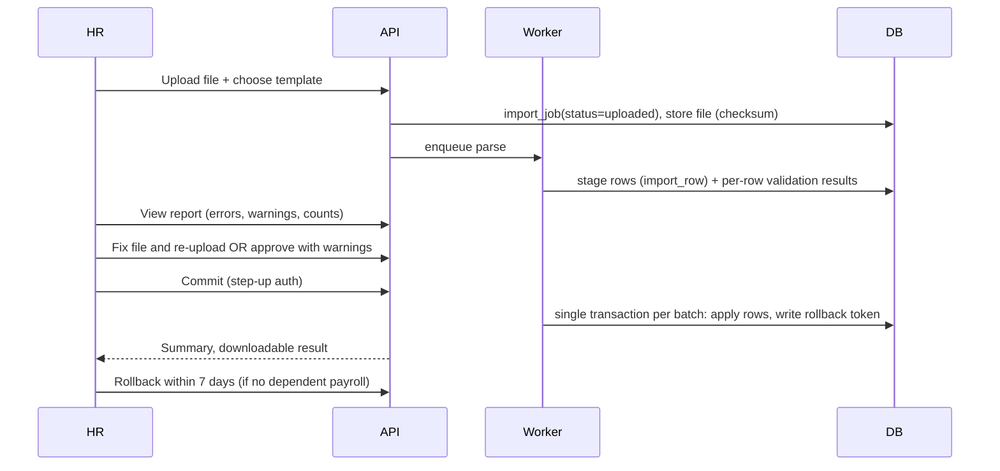

# TDD-import: Employee bulk import with validation report

| | |
|---|---|
| Story/FR | US-103, US-807 / FR-103 |
| Status | Draft |
| ADRs | 001, 007 |

## 1. Problem and scope
Onboard a customer's existing employees from CSV/XLSX without corrupting data. Dry-run first, commit atomically, rollback possible. Reused later for other entities (loans, leave balances, compensation) via the same framework.

## 2. Design

### 2.1 Flow

### 2.2 Tables
`import_job(id, tenant_id, entity, template_version, status, file_key, checksum, created_by, committed_at, rollback_until)`
`import_row(job_id, row_no, raw jsonb, normalized jsonb, status ok|warning|error, messages jsonb, target_id)`
Raw SPI values in staging are field-encrypted and purged 7 days after commit or immediately on cancel.

### 2.3 Templates
Versioned column spec (name, type, required, format, example) downloadable as CSV/XLSX with a data dictionary sheet. Header matching is exact on column key (display labels localised).

### 2.4 Validation layers
1. **File**: size ≤ 10 MB, ≤ 5,000 rows, UTF-8, no formulas/macros (XLSX values only).
2. **Row schema**: types, required fields, enums, dates ISO.
3. **Domain**: TIN/SSS/PhilHealth/Pag-IBIG formats; hire date vs birth date; manager exists; position/org exists; rate within band (warning); duplicate employee number or duplicate (normalised name + DOB) (error unless override column `allow_duplicate_reason`).
4. **Cross-row**: manager cycles, duplicate identifiers within file.
5. **Business warnings**: probation end date missing, MWE flag below regional minimum, etc.

### 2.5 Commit
Order: org → positions → employees → identifiers → employment → compensation → schedules. Idempotent via `(job_id,row_no)` → `target_id`; re-running commit does not duplicate. Audit entries per created entity reference `import_job_id`. Rollback deletes/supersedes only entities created by that job and blocked if they have payroll/leave dependents.

### 2.6 Upsert mode
Optional: match by employee number to update; changes shown as diff in report; effective-dated fields require `effective_from` column.

## 3. Security and privacy
Permission `employee:import` + step-up for commit. Uploaded files encrypted in storage, virus scanned, deleted per retention. Error report CSV masks IDs (last 4). Rate limit jobs per tenant.

## 4. Failure modes
Worker crash mid-commit → transaction rolls back; job returns to `validated`. Large file → streaming parse. Concurrent imports on same entity → job lock per tenant+entity.

## 5. Test plan
Unit: each validator (with Filipino names, Ñ, hyphenated surnames). Integration: dry-run creates nothing; commit then rollback restores state; idempotent commit. Property: any valid file produces same result regardless of row order (except explicit dependency order). Security: formula injection, zip bombs, oversize.

## 6. Rollout
Templates tested with at least two real-world messy spreadsheets (anonymised) before M1 exit (GAP-20).

## 7. Open questions
Legacy payroll history import (YTD for tax annualisation) is a separate template (needed for mid-year go-live); decide at M3.
