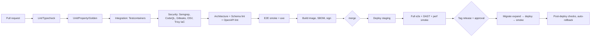

# CI/CD Pipeline

Platform: GitHub Actions. Principles: fast feedback, every gate automated, reproducible builds, evidence retained.

## Git hooks (`.githooks/`, enabled via `git config core.hooksPath .githooks`)
- `pre-commit`: Gitleaks on staged diff, format, lint, typecheck changed packages, block commits containing AI/co-author trailers or secrets patterns.
- `commit-msg`: Conventional Commits format; story id `US-nnn` required.
- `pre-push`: unit tests + Semgrep quick rules + dependency audit; prints the security check report.

## Workflow stages

## Jobs and gates
| Job | Required | Fail policy |
|---|---|---|
| lint-typecheck | Yes | Any error |
| unit-golden-property | Yes | Any failure; coverage floor |
| integration (Postgres, Redis) | Yes | Any failure |
| security-sast (Semgrep, CodeQL) | Yes | High/Critical |
| secrets (Gitleaks) | Yes | Any finding |
| sca (OSV/npm audit + license) | Yes | High/Critical, exploitable |
| iac-scan (Trivy/Checkov) | Yes | High/Critical |
| arch-and-schema-lint | Yes | Any violation |
| openapi-lint-contract | Yes | Any breaking change without version bump |
| e2e-smoke + a11y | Yes | Any failure |
| build-sbom-sign | Yes | Failure |
| nightly: full e2e, mutation, load, DAST | Report | Block release if red |

## Environments and promotion
`feature/*` → PR → `dev` (integration) → `staging` → `main` (prod). Squash-merge; single commit per story. Release tags from `main`.

## Secrets and identity
GitHub OIDC → cloud (no long-lived keys). Environment-scoped secrets with required reviewers for `production`. Actions pinned by SHA. `permissions:` minimal per workflow.

## Evidence bundle (per release)
Test and coverage reports, scan outputs, SBOM, provenance attestation, migration plan, traceability snapshot, approver identity, deploy log. Retained 10 years (audit).

## Caching and speed
Turborepo/pnpm caching; affected-only tests on PR; target PR pipeline ≤ 10 min.

## Rollback
Redeploy previous signed image; DB forward-fix policy. See [deployment](../06-operations/deployment.md).
