# Workflows: How We Work

## The story pipeline
Each story moves through gated stages; evidence artifacts are produced at each.

```mermaid
flowchart LR
  A[1 Intake] --> B[2 Refine: AC, FR/BR links]
  B --> C[3 Design: TDD if needed]
  C --> D[4 Test-first: failing tests]
  D --> E[5 Build]
  E --> F[6 Local gates: pre-commit + security check]
  F --> G[7 PR: CI gates, self-review checklist]
  G --> H[8 Staging: e2e, DAST, UAT]
  H --> I[9 Release: approval, deploy, smoke]
  I --> J[10 Post-release: monitor, retro, docs close]
```

| # | Phase | Output (evidence) | Exit criterion |
|---|---|---|---|
| 1 | Intake | Story in backlog with ID | Linked to epic/milestone |
| 2 | Refine | AC, FR/BR/NFR refs, gaps logged | Testable, sized ≤ 3 days |
| 3 | Design | TDD (if triggered), threat check | Review checklist done |
| 4 | Test-first | Failing tests mapped to FRs | Tests fail for the right reason |
| 5 | Build | Code + docs + migrations | Tests pass locally |
| 6 | Local gates | Security check report (secrets, SAST, deps) | Zero blockers |
| 7 | PR | CI results, coverage, traceability diff | All required checks green |
| 8 | Staging | e2e/DAST/a11y results; UAT notes | No S1/S2 |
| 9 | Release | Signed image, SBOM, change record | Owner approval |
| 10 | Post | Monitoring check, retro, DoD close | Docs updated |

## Roles (solo with hats)
Owner wears Product, BA, Dev, QA, Security, Ops hats. To reduce self-review blindness: checklists, automation, written TDDs, and external review at M0, M3, M8 (peer/mentor or paid reviewer).

## Cadence
- Weekly plan/review (30 min): goals, gap register, risks.
- Milestone gate review: exit criteria, security checklist, retro.
- Monthly: dependency/rule-set review, access review, cost review.
- Quarterly: restore drill, threat model refresh.
- Annually: rule-set year refresh (tax, holidays, minimum wage), pen test.

## Rule-set update workflow (recurring, high-risk)
Monitor agency circulars → draft rule-set version with citation → run golden tests + new cases → second-person approval (SoD, external reviewer for solo) → release as data → notify customers → verify next payroll.

## Documentation workflow
Docs-as-code in same PR. Doc changes to requirements/BRs need traceability update. ADR for any architectural decision. Gap register updated on discovery.

## Communication
Decisions in ADRs, status in weekly notes, incidents in incident record. Customer-facing changes in release notes.
